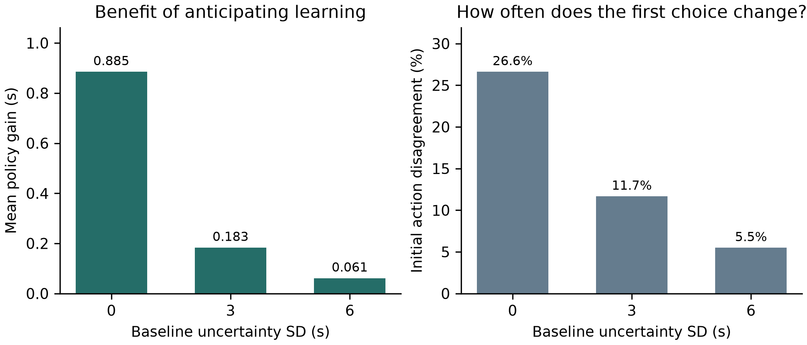
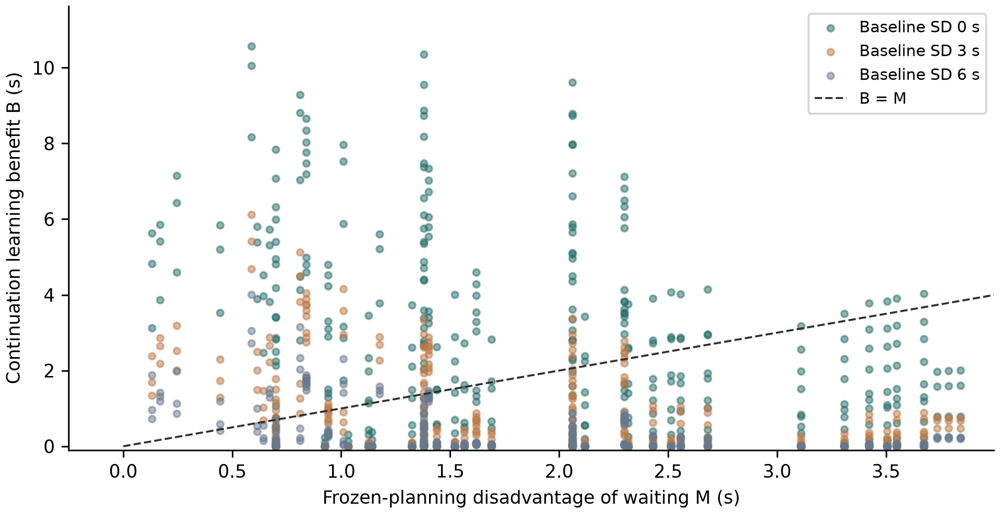

# The Value of Information in Formula One Pit Strategy

## Bayesian stopping with uncertain baseline pace and replacement tyres

Research manuscript · 22 September 2026 · Version 1.0

### Abstract

A pit stop commits a driver to a replacement tyre set, while an additional on-track lap provides information about the current set. This study asks when that information justifies postponing the stop. We formulate a finite-horizon Bayesian stopping problem with two latent degradation regimes, noisy lap observations, a persistent unknown pace baseline, and potentially dependent replacement-tyre performance. We derive an exact condition: at a state where a planner that ignores future learning would pit, the adaptive planner waits if and only if the continuation benefit of learning exceeds the frozen-planning disadvantage of waiting. A conditional-Gaussian reduction preserves a scalar decision belief despite baseline uncertainty. We also establish that independent, mean-preserving replacement uncertainty leaves risk-neutral policies unchanged under linear costs and a final-stop commitment. A protocol-locked numerical study evaluates 2,187 initial states. The adaptive and updating frozen-belief policies differ initially in __DISAGREE__ states (__DISAGREE_PCT__%); __MATERIAL__ states have an estimated gain exceeding 0.05 s. Numerical refinement and paired simulation check 24 deliberately selected cases. Separate historical forecasting experiments show why these model-based gains cannot yet be claimed for real races: a robust estimator improves point accuracy, but adaptive nominal 90% intervals achieve only 85.6% equal-race coverage on three later events. Waiting is therefore justified by decision-relevant, learnable uncertainty relative to the cost of delay, rather than uncertainty alone. The study provides a reproducible model-based answer and explicitly limits its empirical interpretation.

**Keywords:** Formula One; Bayesian optimal stopping; value of information; tyre degradation; decision-making under uncertainty; sequential forecasting.

## 1. Introduction

Pit timing combines an immediate cost with a commitment about future performance. Replacing worn tyres can reduce subsequent lap times, but the stop itself consumes time. A driver who remains on track receives another observation before the next decision. If degradation is uncertain, the action therefore changes both performance and the information available for later choices. The central research question is: **when is it strategically optimal to delay a Formula One pit stop in order to gain additional information about uncertain tyre degradation?**

This question differs from predicting a human team's pit lap. A prediction may reproduce a historical choice without showing that the choice minimizes expected remaining time. It also differs from comparing a fixed pre-race estimate with an estimator that updates. An updating controller can use all observations received so far while ignoring the value of observations that a future action would produce. The relevant comparison holds current information and the inference model fixed and changes only whether planning anticipates learning.

We study this distinction in a deliberately restricted race segment with one optional stop remaining. The formulation is small enough to inspect, solve numerically, and check against independent calculations. It includes two mechanisms that weaken a simple claim that uncertainty should always encourage delay: an unknown baseline can obscure degradation, and uncertainty about replacement tyres can be either learnable from the current set or independent of it. These mechanisms are evaluated without introducing competition, weather, safety cars or energy management.

The contribution is an applied analysis, not a new general theory of Bayesian learning or a claim of first use in motorsport. We provide an interpretable waiting condition, a reduced belief update for a shared baseline, a replacement-uncertainty invariance result, and a systematic numerical characterization of policy differences. Historical forecasts supply a separate assessment of observation-model feasibility. The paper does not estimate causal race-time savings from historical pit decisions and does not present a full operational race strategist.

## 2. Related work and positioning

Dynamic programming already has a substantial role in pit strategy. Aguad and Thraves [1] formulate competition between two drivers as a stochastic feedback Stackelberg game, incorporating compound decisions and uncertain race events. Their objective emphasizes strategic interaction. Our model removes that interaction to isolate the information acquired before committing to a stop. The accessible publisher abstract and section summaries support this comparison; they do not justify a claim that all earlier pit models omit learning.

Cappello and Hoegh [2] develop Bayesian state-space tyre modelling with fuel covariates and pit resets. The published study evaluates rolling-origin forecasts across 19 race sessions and considers alternative degradation and observation specifications. This directly overlaps the inference motivation of the present work. Accurate probabilistic forecasting, however, does not itself measure the decision value of acquiring another observation. Our historical filters are feasibility benchmarks rather than a claimed replacement for that model.

Fieni et al. [3] combine tyre wear, energy allocation and pit timing through mixed-integer nonlinear programming and reinforcement learning. That framework addresses a richer physical decision problem. The phrase learning-based strategy need not mean sequential Bayesian identification of an unknown tyre parameter. We focus specifically on belief updates inside future decision branches, rather than treating the use of a learned policy as evidence of an information-acquisition mechanism.

The methodological foundation is established. Ross, Chaib-draa and Pineau [4] formulate Bayes-adaptive planning that integrates model learning with action selection. Harrison and Sunar [5] study investment timing under costly Bayesian learning, illustrating the broader relationship between information quality, acquisition cost and irreversible decisions. Our stopping condition is an application of these decision principles, not a novel general result. Gneiting and Raftery [6] provide the scoring-rule basis for the historical interval assessment. FastF1 [7] supplies the timing-data interface used in the empirical feasibility component.

## 3. Decision problem

### 3.1 Physical scope and objective

At the initial state, n laps remain and the current tyres have age a. A fixed latent rate θ takes one of two values, θ_L or θ_H, with prior probability p of the high regime. Staying for one lap incurs conditional expected excess time aθ, increases age by one, and yields an observation. Pitting incurs loss L and commits to a replacement set whose excess times are jφ at ages j = 0,...,n−1. No further action is available after that stop. Finishing without another stop is permitted; any earlier compound obligation is assumed satisfied. This is a race-segment model, not a complete regulation-constrained Grand Prix.

The objective is expected remaining time. A common deterministic base lap time is omitted. An uncertain constant baseline b applies to every remaining lap on both tyre sets. For every stopping rule its contribution is nb, so it cancels in policy comparisons. Independent lap noise is used to generate observations; conditional excess costs are scored because the full-horizon, action-independent noise contribution likewise cancels in paired comparisons. The model does not assume that noisy observations reveal noiseless degradation costs.

The observation and initial baseline prior are

$$y_t=b+a_t\theta+\epsilon_t,\quad b\sim N(0,\tau^2),\quad \epsilon_t\sim N(0,\sigma^2).$$

The baseline is independent of the initial joint tyre prior, and noise is independent across laps conditional on the latent variables. A constant shared baseline is restrictive, but its cost treatment is explicit: it is not an observation-only nuisance inserted without a corresponding physical interpretation.

### 3.2 Replacement uncertainty

Replacement rate φ takes values φ_L and φ_H. Define q_L = P(φ=φ_H | θ=θ_L) and q_H = P(φ=φ_H | θ=θ_H). Before the stop, observations depend on θ and b, not directly on φ. The expected replacement rate at belief p is therefore

$$\mu_\phi(p)=\phi_L+(\phi_H-\phi_L)[(1-p)q_L+pq_H].$$

The expected stop cost is

$$P_n(p)=L+\frac{n(n-1)}{2}\mu_\phi(p).$$

This conditional mean changes with current-set observations when q_L and q_H differ. Replacement observations after stopping have no decision value because the model contains no subsequent choice. This is a consequence of the action set, not a claim that replacement observations are uninformative in actual races.

### 3.3 Policies and oracles

We distinguish four substantive policies. The fixed-prior policy selects a schedule using the initial belief and ignores subsequent observations. The updating frozen-belief policy receives each real observation and replans, but holds the current belief fixed during lookahead. The adaptive policy anticipates future observations and the resulting posterior-dependent actions. A full-information oracle knows both tyre regimes while retaining the same physical stop options. A second, weaker oracle knows only the old-tyre regime and uses the corresponding conditional replacement mean.

For a fixed stopping schedule, costs are affine in θ and φ. Taking their expectation under a posterior is consequently identical to evaluating that schedule at the posterior means. A certainty-equivalent planner and a planner propagating the frozen posterior therefore coincide here. We do not count them as distinct algorithms or manufacture a nonlinear extension solely to separate them. A strict benefit from passive posterior propagation over posterior means cannot be demonstrated in this model.

## 4. Bayesian learning and optimal stopping

### 4.1 Integrating the unknown baseline

After t observations on the current set, let S_y be their sum and S_a their age sum. Conditional on each old-tyre regime, the baseline posterior is Gaussian with variance v_t and mean k_t(S_y−θS_a), where

$$k_t=\frac{\tau^2}{\sigma^2+t\tau^2},\qquad v_t=\sigma^2 k_t.$$

Center the next observation by z_t = y_t−k_tS_y and define h_t = a_t−k_tS_a. Then

$$z_t\mid\theta,\mathcal{H}_t\sim N(h_t\theta,\sigma^2+v_t).$$

Both h_t and v_t depend on the known ages and observation count, rather than the values of previous observations. The old-regime posterior is obtained from the two normal likelihoods and the current p. The full joint posterior contains more than p, but the transition distribution of the cost-relevant next belief depends only on p and t after centering. The planner can therefore retain a one-dimensional belief grid. A physical replay still retains S_y to center its next observation; we do not claim that p reconstructs the full joint posterior.

The physical age a_t remains in the cost function. Replacing it there with h_t would incorrectly reduce tyre wear rather than account for confounding in the observations. At τ=0 the formulation exactly recovers the known-baseline model. A changing or tyre-specific baseline would generally invalidate this reduction.

### 4.2 Bellman recursions

Let c(a,p)=a[(1−p)θ_L+pθ_H]. Let F_n denote the frozen-planning value and V_n the adaptive value. Time dependence of the observation kernel is implicit. The terminal values are zero, and ties select pit:

$$F_n(a,p)=\min\{P_n(p),\ c(a,p)+F_{n-1}(a+1,p)\},$$

$$V_n(a,p)=\min\{P_n(p),\ c(a,p)+E_y[V_{n-1}(a+1,p_y)]\}.$$

F_n is not the actual deployed cost of the updating frozen-belief policy. That policy changes its belief after each observation, so its performance is evaluated with a separate recursion using its actions and the true predictive transition. F_n does equal the expected cost of the optimal fixed-belief schedule starting at that state. Confusing these quantities would overstate or mislabel the comparison of policies.

### 4.3 Necessary and sufficient condition for information-induced delay

Define the frozen-planning disadvantage of staying, M, and the continuation benefit of learning, B:

$$M=c(a,p)+F_{n-1}(a+1,p)-P_n(p),$$

$$B=F_{n-1}(a+1,p)-E_y[V_{n-1}(a+1,p_y)].$$

**Proposition 1.** At a state where the frozen-belief planner pits, the adaptive planner strictly prefers to stay if and only if B > M ≥ 0.

**Proof.** The frozen planner pits precisely when M≥0 under the specified tie rule. Substituting the definitions gives adaptive stay cost minus immediate pit cost equal to M−B. Strict preference for staying is therefore equivalent to B>M. This condition is exact within the model; its numerical implementation is approximate.

Adding and subtracting the expected next frozen value decomposes B into the benefit of the next observation followed by no further learning, plus the benefit of additional learning opportunities after that observation. F is the minimum of affine fixed-schedule costs and is concave in the belief. The posterior is a martingale under the correctly specified model, so Jensen's inequality makes the first component nonnegative. The adaptive policy can ignore information, implying V≤F and a nonnegative second component. At the last decision both continuation values vanish, so information cannot justify waiting merely to finish the race.

This does not prove that improvements are concentrated near a universal strategy boundary or that they increase monotonically with variance. A large learning benefit can exceed a large waiting disadvantage. The proposition identifies a cost comparison, not a variance threshold. Moreover, correct-model dominance is a property of the optimisation problem, not an empirical discovery or guarantee under misspecification.

### 4.4 Independent replacement uncertainty

**Proposition 2.** With linear costs, expected-time optimisation, no direct pre-stop replacement observations and no subsequent decision after pitting, replacement uncertainty independent of θ and b affects the Bellman recursions only through its mean.

**Proof.** Independence implies q_L=q_H, so μ_φ(p) is constant. The stop cost is then identical to that of a known replacement rate equal to this mean at every state. Neither the old-set observation kernel nor the stay cost changes. Backward induction yields identical F, V and deployed frozen-policy values, and the same actions under the common tie rule. Realized costs and an oracle's information may still differ. Risk constraints, nonlinear losses and additional decisions are outside the result.

## 5. Experimental design and verification

### 5.1 Protocol-locked numerical study

Exploratory experiments developed and checked the model before the final study. The final configuration was written and hashed before its successful run. This is a post-development protocol lock, not external preregistration or independent empirical confirmation. One technical amendment converted NumPy integer indices to serializable Python integers; the original protocol and failed-output record are retained, and all computations were repeated without changing scientific settings.

The final grid varies seven dimensions, with three values each. It contains 2,187 equally weighted initial states. The old-set rates remain 0.04 and 0.30 s per lap of tyre age; replacement rates remain 0.02 and 0.10. Initial states are hypothetical scenarios, not observations sampled according to race frequency.

| Dimension | Values |
|---|---|
| Remaining laps n | 4, 8, 12 |
| Starting tyre age a | 8, 12, 16 |
| Pit loss L (s) | 12, 18, 24 |
| High-regime prior p | 0.2, 0.5, 0.8 |
| Independent observation SD σ (s) | 0.75, 1.5, 3 |
| Shared baseline SD τ (s) | 0, 3, 6 |
| Dependence parameter r | −0.75, 0, +0.75 |

The conditional replacement probabilities are q_L=(1−r)/2 and q_H=(1+r)/2. The parameter r equals the binary-regime correlation only at the equal old-regime prior; elsewhere it labels this conditional-probability construction. Conditional distributions, rather than a universal correlation interpretation, define the experiment. Across different p values, correlated cases need not retain the same replacement marginal mean.

Main computations use 1,601 equally spaced belief points and 81-point Gauss-Hermite quadrature, with linear interpolation. All grid cells are retained. We summarize expected policy gain G=J_frozen−J_adaptive, oracle regret, initial action disagreement and the waiting margin. A declared 0.05 s threshold distinguishes gains of that size from smaller numerical effects; it is a reporting threshold rather than a claim of practical race significance. Near-boundary states are defined before evaluation by |M|≤1 s. Other states use |M|>1 s.

### 5.2 Independent checks

A deterministic selection rule chooses 24 validation states: 12 evenly spaced grid indices, six additional largest-gain states, and six additional states with the smallest absolute adaptive stay-versus-pit advantage. Ties are broken by index. This intentionally probes extremes and decision boundaries and is not a representative sample. Each selected state is recomputed using 6,401 belief points and 161 quadrature nodes and evaluated with 50,000 paired trajectories, totaling 1.2 million paired trajectories.

Physical rollouts draw the old and replacement regimes from their joint prior, then draw a persistent baseline and independent lap noise. Policies share the latent variables and noise. Before a stop they receive only observations generated on their current-set history; after a stop no further decision is made. The evaluator scores actual sampled replacement rates. For paired cost differences Δ_i, the reported simulation interval is mean(Δ) ± 1.96 SD(Δ)/√N. It quantifies Monte Carlo sampling uncertainty, not structural model error, generalization or multiple-comparison significance.

The 47-test suite checks known-regime schedule enumeration, finite-model limiting cases, sequential posteriors against dense Gaussian likelihoods, a three-lap independently nested integral, original-model recovery at zero baseline uncertainty, replacement invariance across belief grids, and physical rollout agreement. Historical tests check that future observations cannot alter prior forecasts or intervals. Numerical-refinement differences are diagnostics rather than certified error bounds.

## 6. Synthetic results

### 6.1 Overall policy comparison

__OVERALL_PARAGRAPH__

__SUMMARY_TABLE__

The mean is a descriptive average over this artificial grid, not an expected gain for a typical race. The fixed-prior comparator deliberately discards actual observations and is weaker than the updating frozen-belief comparator. The latter is the primary comparison because it isolates anticipating learning from merely receiving information.

### 6.2 Does value concentrate near the frozen boundary?

__BOUNDARY_PARAGRAPH__

This comparison concerns the frozen planner's raw cost margin, not an optimally chosen retrospective boundary. It does not establish a universal concentration law. The exact decision condition remains B>M: similarity of immediate planning costs can help, but it is neither sufficient nor necessary for a large absolute learning benefit. Observations must also distinguish latent cases that call for different continuation decisions.

### 6.3 Baseline uncertainty and replacement dependence

A matched illustrative case holds horizon, age, degradation, noise and pit loss fixed at 8 laps, age 12, rates 0.04/0.30, observation SD 1.5 s and pit loss 18 s. With known replacement rate 0.06, increasing baseline SD from 0 to 1.5, 3 and 6 s gives fine-resolution gains of 4.387, 2.673, 1.146 and 0.000 s. The selected initial action changes from stay to pit at the last sampled setting. This is a sensitivity comparison, not an estimated universal threshold.

Replacement uncertainty yields a different distinction. At baseline SD 3 s, known replacement performance and independent uncertain replacement performance have identical main-resolution gains of 1.136 s. Positive and negative dependence give 1.020 and 1.253 s, respectively. Their uncertain replacement marginals are identical at p=0.5; changing the joint relationship changes both cross-set learning and conditional physical payoffs. It is not purely a manipulation of observation quality. At baseline SD 6 s, negative dependence produces a nominal gain of only about 0.01 s, with a simulation interval crossing zero widely. We do not interpret that marginal recommendation as a reliably meaningful advantage.

### 6.4 Misspecification and numerical limits

A development stress test generates observations with actual baseline SD 6 s while both policies assume zero baseline uncertainty. The adaptive-minus-comparator comparison, oriented as positive gain for the adaptive policy, is −0.145 s with 95% paired interval [−0.273,−0.017] across 30,000 trajectories. Assuming SD 1.5 gives −0.070 s with interval [−0.199,0.058]. Correctly assuming SD 6 leads both policies to pit immediately and yields zero difference. This demonstrates why an internal value of information under a wrong model need not translate into a benefit under the generating process. These are development comparisons rather than a corrected population-level hypothesis test.

__VALIDATION_PARAGRAPH__

## 7. Historical forecasting feasibility

### 7.1 Data and sequential evaluation

Historical analysis uses FastF1 version 3.8.3 [7] and the first eleven 2024 Grand Prix race sessions from Bahrain through Austria. The ingestion pipeline records source hashes, retrieval times and exclusion reasons. Eligible observations have available positive lap time and tyre age, dry compounds, green-flag track status, no pit entry or exit, no generated lap, a positive accuracy flag, and are not the first race lap. No post-hoc lap-time threshold removes difficult targets. These are retrospective quality filters. The study has not established that every flag and corrected timing field was available at the corresponding live decision time.

The forecasting sequence preserves whole-event test splits for each successive version. Bahrain supplies initial development data; Saudi Arabia is the first test. Australia, Japan and China test that frozen model again. After those outcomes motivate redesign, all five inspected races become development data and Miami, Emilia Romagna and Monaco form a new test group. Finally, all eight inspected races support interval calibration before Canada, Spain and Austria are assessed. Previously inspected events are not reused as untouched tests for later versions. Across these ten test events there are 7,752 scored targets, but the model changes between stages, so this is not one homogeneous validation sample.

Within each driver and stint, the first three eligible observations initialize the model and are not scored. Every subsequent prediction is stored before updating with its target; gaps use actual elapsed tyre age. The original model is a local Gaussian pace/slope filter. The robust revision uses a median warm start, zero initial slope and clipped innovations; its covariance is a working scale, not an exact posterior. The selected robust settings are observation and level-process SD 0.6, clip 2.5 predictive SDs and no gap reset. Selection considers 54 configurations using equal-race development MAE.

The interval revision retains the robust point estimates and adapts only interval widths. It combines a 201-point, race-balanced development residual distribution with the preceding 20 scored errors of the same driver, giving the prior the weight of 15 observations. This choice is selected from six development configurations and frozen before the final three events. The 90% interval score is width plus 20 times the distance of a missed observation from the closest interval bound [6]. The procedure has no claimed coverage guarantee.

### 7.2 Results and their interpretation

The initial Saudi test contains 688 targets: model MAE is 0.375 s versus 0.372 s for the previous-lap predictor, with lower RMSE but no MAE improvement. On the next 1,869 targets from Australia, Japan and China, equal-race MAE is 0.434 s versus 0.368 s, about 18.0% worse. The failure is preserved. A contaminated initialization in Japan provides a concrete reason to test robust starts rather than report only successful events.

On 2,922 later targets, robust estimation reduces equal-race MAE by 6.31% relative to the previous-lap baseline, from 0.4520 to 0.4235 s, and by 4.75% relative to the original model. Its nominal 90% coverage averages only 84.99%. Table 3 reports each event rather than treating thousands of dependent laps as thousands of independent races.

| Event | Targets | Robust MAE (s) | Previous-lap MAE (s) | Robust 90% coverage |
|---|---:|---:|---:|---:|
| Miami | 793 | 0.3065 | 0.3174 | 92.43% |
| Emilia Romagna | 1,027 | 0.3796 | 0.4088 | 86.76% |
| Monaco | 1,102 | 0.5844 | 0.6299 | 75.77% |
| Equal-race mean | 2,922 total | 0.4235 | 0.4520 | 84.99% |

On 2,273 subsequent targets, adaptive interval widths improve the equal-race interval score by 11.2% relative to recalibrated static intervals, from 5.595 to 4.968. Coverage rises from 79.96% to 85.59%, still below 90%. Canada contributes only 190 scored dry-compound eligible observations, not validation of the whole wet or mixed-condition race.

| Event | Targets | Adaptive coverage | Static coverage | Adaptive interval score | Static score |
|---|---:|---:|---:|---:|---:|
| Canada | 190 | 77.37% | 59.47% | 9.487 | 10.978 |
| Spain | 1,020 | 88.73% | 87.84% | 3.099 | 3.272 |
| Austria | 1,063 | 90.69% | 92.57% | 2.317 | 2.534 |
| Equal-race mean | 2,273 total | 85.59% | 79.96% | 4.968 | 5.595 |

Static here means recalibration on the same development pool without online width adaptation. All interval methods share identical point predictions. Event means, including mean event RMSE elsewhere in the records, are not interchangeable with pooled-lap statistics. Three-event groups support descriptive replication, not a broad population significance claim.

### 7.3 Why these observations do not validate strategy gains

Net pace trends combine tyre effects, fuel burn, track evolution, traffic and driving choices. Historical prediction intervals describe future observed laps, not posterior uncertainty in a physically identified tyre parameter. Better point accuracy or a better interval score cannot be substituted for a correct observation likelihood in the stopping model. Nor does historical timing reveal the outcome of an unchosen replacement strategy. Once a counterfactual stop differs from history, the recorded continuation cannot simply be fed to that alternative policy as its own observations.

Accordingly, this paper reports historical forecasting feasibility, not leakage-free historical decision replay, empirical oracle regret, or causal pit savings. The failure to achieve the desired predictive coverage and the unresolved as-of-data audit are substantive limits on deployment. They are included in the answer rather than hidden behind favorable synthetic gains.

## 8. Discussion

The model-based answer has three parts. First, the relevant quantity is a decision benefit, not an uncertainty measure by itself: the continuation learning benefit must exceed the cost disadvantage of delaying. Second, the observations must be capable of resolving uncertainty about relative continuation costs. A shared unknown baseline reduces that capability, while dependence between tyre sets changes what an observation implies about the alternative. Third, the model used to value information must be sufficiently accurate. An adaptive controller can pay to obtain evidence it misinterprets.

Several initially plausible hypotheses require qualification. Passive posterior propagation does not beat posterior means for this linear fixed-schedule problem. Correct-model adaptive dominance is built into the optimisation and should not be advertised as a discovered advantage of an algorithm. Boundary concentration depends on the state distribution and the chosen definition of a boundary. Independent replacement variance is irrelevant to expected decisions here, despite changing outcome variability. These qualifications make the research question more precise than a generic claim that Bayesian methods improve strategy.

The numerical grid varies hypothetical states, not races, and its mean gain is sensitive to the chosen ranges and weights. The belief prior and tyre rates are illustrative. Grid interpolation and quadrature can affect marginal decisions; the additional calculations probe but do not certify numerical error. The model's stopping commitment omits multiple future stops, compound legality, opponents, warm-up, tyre cliffs, track position, safety cars and weather. It optimises expected time rather than winning probability or a risk-sensitive objective. The shared-baseline reduction does not address arbitrary time-varying or tyre-specific confounding.

A practical extension would need a physically interpretable observation model, posterior checks on identifiable latent quantities, event-level validation of the simulator, a documented live-information set and a counterfactual design that does not recycle factual trajectories after policy divergence. Those requirements are not achieved by enlarging the current synthetic grid. The portfolio implementation is useful as an inspectable decision experiment; its interface should retain these distinctions instead of presenting the recommendation as operational advice.

## 9. Conclusion

Delaying a pit stop to learn is optimal in the stated finite-horizon model exactly when the expected continuation benefit of learning exceeds the frozen-planning disadvantage of waiting. This benefit can be substantial in selected states, vanish when baseline ambiguity obscures tyre performance, and become harmful under a misspecified observation model. Independent replacement uncertainty with the same mean does not change the policy under the model's linear, risk-neutral final-stop assumptions; dependence between tyre sets can change it.

The systematic study and independent checks quantify these conditions for a reproducible model. Historical forecasts provide mixed evidence for the observation component and do not validate real-race strategy improvements. The supported conclusion is therefore conditional and specific: information-aware pit timing is a coherent and sometimes valuable mechanism, but uncertainty alone is not a reason to wait, and simulated value is not evidence of an achieved racing advantage.

## Data, code and computational provenance

The accompanying source archive contains the model implementations, tests, experiment protocols, saved numerical outputs, historical evaluation summaries and manuscript sources. The final-study record includes the protocol digest and model-source hashes. Raw timing caches are omitted; retrieval code and event selections are retained. Access to historical feeds and their reuse is subject to the source providers' terms; the archive does not purport to grant rights over third-party timing data. No public repository, DOI, journal submission or acceptance is claimed.

The research runtime uses Python 3.13.3, NumPy 2.2.5, SciPy 1.15.2, pandas 2.3.3, FastF1 3.8.3 and Matplotlib 3.11.2. Main synthetic results can be reproduced without downloading race data. Historical evaluation records are retained in their originally frozen versions; reproduction of ingestion depends on external feed availability. The supplement describes commands, output mappings, numerical caveats and the technical serialization amendment.

**AI assistance disclosure.** AI assistance was used to develop code, derive and check formulations, inspect sources and draft the manuscript. The included numerical checks are not a substitute for author responsibility or independent peer review. This version contains no fabricated authorship, affiliation or peer-review status.

## References

[1] Aguad, F., and Thraves, C. (2024). Optimizing pit stop strategies in Formula 1 with dynamic programming and game theory. *European Journal of Operational Research*, 319(3), 908-919. https://doi.org/10.1016/j.ejor.2024.07.011

[2] Cappello, C., and Hoegh, A. (2026). A state-space approach to modeling tire degradation in formula 1 racing. *Journal of Sports Analytics*. https://doi.org/10.1177/22150218261446170

[3] Fieni, G., Wüthrich, J., Neumann, M.-P., Moradi, M. H., and Onder, C. H. (2025). Towards Learning-Based Formula 1 Race Strategies. *arXiv*, 2512.21570v1. https://arxiv.org/abs/2512.21570

[4] Ross, S., Chaib-draa, B., and Pineau, J. (2007). Bayes-Adaptive POMDPs. *Advances in Neural Information Processing Systems*, 20. https://papers.nips.cc/paper/3333-bayes-adaptive-pomdps

[5] Harrison, J. M., and Sunar, N. (2015). Investment Timing with Incomplete Information and Multiple Means of Learning. *Operations Research*, 63(2), 442-457. Author manuscript record: https://ssrn.com/abstract=2558568

[6] Gneiting, T., and Raftery, A. E. (2007). Strictly Proper Scoring Rules, Prediction, and Estimation. *Journal of the American Statistical Association*, 102(477), 359-378. https://doi.org/10.1198/016214506000001437

[7] FastF1 contributors. *FastF1*, version 3.8.3. Software and documentation, accessed 22 September 2026. https://github.com/theOehrly/Fast-F1
