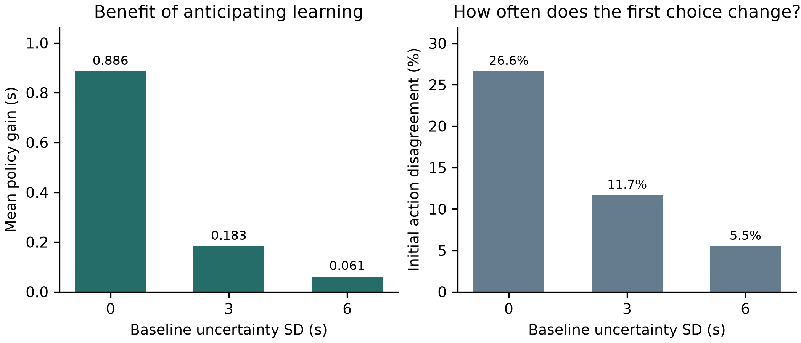
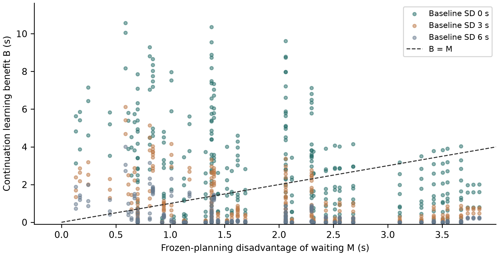

# The Value of Information in Formula One Pit Strategy

## Bayesian stopping and conditional historical replay

Research manuscript · 22 September 2026 · Version 2.0

### Abstract

A pit stop replaces worn tyres but ends the opportunity to learn about their degradation before committing. We ask when another lap of information justifies delaying that stop. A finite-horizon Bayesian stopping model incorporates two degradation regimes, noisy observations, an unknown persistent baseline and dependent replacement performance. Waiting is optimal when the continuation benefit of learning exceeds the immediate planning disadvantage. Independent replacement uncertainty affects risk-neutral decisions only through its mean. Analytic integration across policy boundaries stabilizes a 2,187-state study: adaptive and updating certainty-equivalent policies differ initially in 319 states, with mean simulated benefit 0.377 seconds. Twenty-four refined cases agree with independent paired simulation. A frozen historical replay evaluates 2,173 forecasts and 526 late-race decision states across three unused events. The adaptive policy delays eleven initial stops, but the observation model predicts worse than a last-lap baseline in every event, and recommendations depend on nuisance assumptions. Synthetic recovery tests demonstrate severe posterior overconfidence under unmodelled trends. Thus learnable, decision-relevant uncertainty can justify waiting within the model, while the historical results do not establish operational savings. The contribution is a reproducible mechanism study, a numerical evaluation correction and a conditional empirical test that exposes the limits of translating uncertainty into strategy.

**Keywords:** Formula One; Bayesian optimal stopping; value of information; tyre degradation; decision-making under uncertainty; sequential forecasting.

## 1. Introduction

Pit timing combines an immediate cost with a commitment about future performance. Replacing worn tyres can reduce subsequent lap times, but the stop itself consumes time. A driver who remains on track receives another observation before the next decision. If degradation is uncertain, the action therefore changes both performance and the information available for later choices. The central research question is: **when is it strategically optimal to delay a Formula One pit stop in order to gain additional information about uncertain tyre degradation?**

This question differs from predicting a human team's pit lap. A prediction may reproduce a historical choice without showing that the choice minimizes expected remaining time. It also differs from comparing a fixed pre-race estimate with an estimator that updates. An updating controller can use all observations received so far while ignoring the value of observations that a future action would produce. The relevant comparison holds current information and the inference model fixed and changes only whether planning anticipates learning.

We study this distinction in a deliberately restricted race segment with one optional stop remaining. The formulation is small enough to inspect, solve numerically, and check against independent calculations. It includes two mechanisms that weaken a simple claim that uncertainty should always encourage delay: an unknown baseline can obscure degradation, and uncertainty about replacement tyres can be either learnable from the current set or independent of it. These mechanisms are evaluated without introducing competition, weather, safety cars or energy management.

The contribution is an applied analysis, not a new general theory of Bayesian learning or a claim of first use in motorsport. We provide an interpretable waiting condition, a reduced belief update for a shared baseline, a replacement-uncertainty invariance result, and a systematic numerical characterization of policy differences. Historical forecasts and a separately frozen three-event conditional decision replay assess the observation-to-decision connection. The paper does not estimate causal race-time savings from historical pit decisions and does not present a full operational race strategist.

## 2. Related work and contribution

Aguad and Thraves (2024) formulate pit-stop competition as a stochastic feedback Stackelberg game. Their objective concerns strategic interaction between drivers. Our problem removes opponents to isolate information acquired before a final-stop commitment. The accessible publisher and author-preprint abstracts support this distinction; the final article's full text was not available for a complete observation-model audit. We therefore make no claim that previous pit models universally omit learning.

Cappello and Hoegh (2026) model latent tyre performance with Bayesian state-space methods, fuel covariates and pit resets. Their published evaluation spans 19 sessions. Our empirical inference is substantially simpler and is not proposed as a superior forecasting method. The question here is whether a planner should incur another lap's cost because of the decisions enabled by its observation. Forecasting accuracy and that decision value are different targets.

Fieni et al. (2025) jointly optimize energy allocation, wear and pit timing using nonlinear optimization and reinforcement learning. Their Section 4.2 explicitly specifies a fully observable environment, and Section 4.4 deterministic nominal transitions. Our uncertainty is instead a hidden degradation regime inferred from lap observations. This contrast applies to the inspected version and does not imply that learning-based race strategy as a broader field excludes partial observability. The authors' institutional publication record continues to list the work as submitted, so it is cited as a preprint.

Heilmeier et al. (2020) use neural networks to select stops and compounds inside a race simulation. Sasikumar et al. (2025) assess deep-learning pit-decision predictions using classification metrics. These establish relevant simulation and predictive precedents. Reproducing observed decisions or achieving a classification score does not by itself measure the reward of acquiring another observation. We compare two planners sharing the same current belief and actual update rule, so the controlled difference is whether hypothetical future observations enter planning.

Ross, Chaib-draa and Pineau (2007) provide the Bayes-adaptive planning foundation. Harrison and Sunar (2015) study costly learning and investment timing with a binary unknown value. Our waiting condition is an application of established information and stopping principles, not a novel general theorem. Gneiting and Raftery (2007) motivate proper probabilistic scoring; FastF1 contributors (2026) provide the historical timing interface.

The contribution is an inspectable applied characterization of learning before a tyre-replacement commitment. It distinguishes baseline ambiguity from learnable degradation, separates independent replacement variance from cross-set dependence, and shows why deployed certainty-equivalent policy values require careful numerical treatment. The new historical test is deliberately capable of returning a negative result. Its failure of forecast transfer limits the interpretation of favourable conditional policy values. This targeted literature review supports that positioning without establishing priority or claiming an exhaustive search.

## 3. Decision problem

### 3.1 Physical scope and objective

At the initial state, n laps remain and the current tyres have age a. A fixed latent rate θ takes one of two values, θ_L or θ_H, with prior probability p of the high regime. Staying for one lap incurs conditional expected excess time aθ, increases age by one, and yields an observation. Pitting incurs loss L and commits to a replacement set whose excess times are jφ at ages j = 0,...,n−1. No further action is available after that stop. Finishing without another stop is permitted; any earlier compound obligation is assumed satisfied. This is a race-segment model, not a complete regulation-constrained Grand Prix.

The objective is expected remaining time. A common deterministic base lap time is omitted. An uncertain constant baseline b applies to every remaining lap on both tyre sets. For every stopping rule its contribution is nb, so it cancels in policy comparisons. Independent lap noise is used to generate observations; conditional excess costs are scored because the full-horizon, action-independent noise contribution likewise cancels in paired comparisons. The model does not assume that noisy observations reveal noiseless degradation costs.

The observation and initial baseline prior are

$$y_t=b+a_t\theta+\epsilon_t,\quad b\sim N(0,\tau^2),\quad \epsilon_t\sim N(0,\sigma^2).$$

The baseline is independent of the initial joint tyre prior, and noise is independent across laps conditional on the latent variables. A constant shared baseline is restrictive, but its cost treatment is explicit: it is not an observation-only nuisance inserted without a corresponding physical interpretation.

### 3.2 Replacement uncertainty

Replacement rate φ takes values φ_L and φ_H. Define q_L = P(φ=φ_H | θ=θ_L) and q_H = P(φ=φ_H | θ=θ_H). Before the stop, observations depend on θ and b, not directly on φ. The expected replacement rate at belief p is therefore

$$\mu_\phi(p)=\phi_L+(\phi_H-\phi_L)[(1-p)q_L+pq_H].$$

The expected stop cost is

$$P_n(p)=L+\frac{n(n-1)}{2}\mu_\phi(p).$$

This conditional mean changes with current-set observations when q_L and q_H differ. Replacement observations after stopping have no decision value because the model contains no subsequent choice. This is a consequence of the action set, not a claim that replacement observations are uninformative in actual races.

### 3.3 Policies and oracles

We distinguish four substantive policies. The fixed-prior policy selects a schedule using the initial belief and ignores subsequent observations. The updating frozen-belief policy receives each real observation and replans, but holds the current belief fixed during lookahead. The adaptive policy anticipates future observations and the resulting posterior-dependent actions. A full-information oracle knows both tyre regimes while retaining the same physical stop options. A second, weaker oracle knows only the old-tyre regime and uses the corresponding conditional replacement mean.

For a fixed stopping schedule, costs are affine in θ and φ. Taking their expectation under a posterior is consequently identical to evaluating that schedule at the posterior means. A certainty-equivalent planner and a planner propagating the frozen posterior therefore coincide here. We do not count them as distinct algorithms or manufacture a nonlinear extension solely to separate them. A strict benefit from passive posterior propagation over posterior means cannot be demonstrated in this model.

## 4. Bayesian learning and optimal stopping

### 4.1 Integrating the unknown baseline

After t observations on the current set, let S_y be their sum and S_a their age sum. Conditional on each old-tyre regime, the baseline posterior is Gaussian with variance v_t and mean k_t(S_y−θS_a), where

$$k_t=\frac{\tau^2}{\sigma^2+t\tau^2},\qquad v_t=\sigma^2 k_t.$$

Center the next observation by z_t = y_t−k_tS_y and define h_t = a_t−k_tS_a. Then

$$z_t\mid\theta,\mathcal{H}_t\sim N(h_t\theta,\sigma^2+v_t).$$

Both h_t and v_t depend on the known ages and observation count, rather than the values of previous observations. The old-regime posterior is obtained from the two normal likelihoods and the current p. The full joint posterior contains more than p, but the transition distribution of the cost-relevant next belief depends only on p and t after centering. The planner can therefore retain a one-dimensional belief grid. A physical replay still retains S_y to center its next observation; we do not claim that p reconstructs the full joint posterior.

The physical age a_t remains in the cost function. Replacing it there with h_t would incorrectly reduce tyre wear rather than account for confounding in the observations. At τ=0 the formulation exactly recovers the known-baseline model. A changing or tyre-specific baseline would generally invalidate this reduction.

### 4.2 Bellman recursions

Let c(a,p)=a[(1−p)θ_L+pθ_H]. Let F_n denote the frozen-planning value and V_n the adaptive value. Time dependence of the observation kernel is implicit. The terminal values are zero, and ties select pit:

$$F_n(a,p)=\min\{P_n(p),\ c(a,p)+F_{n-1}(a+1,p)\},$$

$$V_n(a,p)=\min\{P_n(p),\ c(a,p)+E_y[V_{n-1}(a+1,p_y)]\}.$$

F_n is not the actual deployed cost of the updating frozen-belief policy. That policy changes its belief after each observation, so its performance is evaluated with a separate recursion using its actions and the true predictive transition. F_n does equal the expected cost of the optimal fixed-belief schedule starting at that state. Confusing these quantities would overstate or mislabel the comparison of policies.

### 4.3 Necessary and sufficient condition for information-induced delay

Define the frozen-planning disadvantage of staying, M, and the continuation benefit of learning, B:

$$M=c(a,p)+F_{n-1}(a+1,p)-P_n(p),$$

$$B=F_{n-1}(a+1,p)-E_y[V_{n-1}(a+1,p_y)].$$

**Proposition 1.** At a state where the frozen-belief planner pits, the adaptive planner strictly prefers to stay if and only if B > M ≥ 0.

**Proof.** The frozen planner pits precisely when M≥0 under the specified tie rule. Substituting the definitions gives adaptive stay cost minus immediate pit cost equal to M−B. Strict preference for staying is therefore equivalent to B>M. This condition is exact within the model; its numerical implementation is approximate.

Adding and subtracting the expected next frozen value decomposes B into the benefit of the next observation followed by no further learning, plus the benefit of additional learning opportunities after that observation. F is the minimum of affine fixed-schedule costs and is concave in the belief. The posterior is a martingale under the correctly specified model, so Jensen's inequality makes the first component nonnegative. The adaptive policy can ignore information, implying V≤F and a nonnegative second component. At the last decision both continuation values vanish, so information cannot justify waiting merely to finish the race.

This does not prove that improvements are concentrated near a universal strategy boundary or that they increase monotonically with variance. A large learning benefit can exceed a large waiting disadvantage. The proposition identifies a cost comparison, not a variance threshold. Moreover, correct-model dominance is a property of the optimisation problem, not an empirical discovery or guarantee under misspecification.

### 4.4 Independent replacement uncertainty

**Proposition 2.** With linear costs, expected-time optimisation, no direct pre-stop replacement observations and no subsequent decision after pitting, replacement uncertainty independent of θ and b affects the Bellman recursions only through its mean.

**Proof.** Independence implies q_L=q_H, so μ_φ(p) is constant. The stop cost is then identical to that of a known replacement rate equal to this mean at every state. Neither the old-set observation kernel nor the stay cost changes. Backward induction yields identical F, V and deployed frozen-policy values, and the same actions under the common tie rule. Realized costs and an oracle's information may still differ. Risk constraints, nonlinear losses and additional decisions are outside the result.

## 5. Experimental design and verification

### 5.1 Protocol-locked numerical study

Exploratory experiments developed and checked the model before the final study. The final configuration was written and hashed before its successful run. This is a post-development protocol lock, not external preregistration or independent empirical confirmation. One technical amendment converted NumPy integer indices to serializable Python integers; the original protocol and failed-output record are retained, and all computations were repeated without changing scientific settings.

The final grid varies seven dimensions, with three values each. It contains 2,187 equally weighted initial states. The old-set rates remain 0.04 and 0.30 s per lap of tyre age; replacement rates remain 0.02 and 0.10. Initial states are hypothetical scenarios, not observations sampled according to race frequency.

| Dimension | Values |
|---|---|
| Remaining laps n | 4, 8, 12 |
| Starting tyre age a | 8, 12, 16 |
| Pit loss L (s) | 12, 18, 24 |
| High-regime prior p | 0.2, 0.5, 0.8 |
| Independent observation SD σ (s) | 0.75, 1.5, 3 |
| Shared baseline SD τ (s) | 0, 3, 6 |
| Dependence parameter r | −0.75, 0, +0.75 |

The conditional replacement probabilities are q_L=(1−r)/2 and q_H=(1+r)/2. The parameter r equals the binary-regime correlation only at the equal old-regime prior; elsewhere it labels this conditional-probability construction. Conditional distributions, rather than a universal correlation interpretation, define the experiment. Across different p values, correlated cases need not retain the same replacement marginal mean.

Revised main computations use 1,601 equally spaced belief points with analytic integration of affine posterior segments and explicit deployed-policy action boundaries (Appendix A). All grid cells are retained. We summarize expected policy gain G=J_frozen−J_adaptive, oracle regret, initial action disagreement and the waiting margin. A declared 0.05 s threshold distinguishes gains of that size from smaller numerical effects; it is a reporting threshold rather than a claim of practical race significance. Near-boundary states are defined before evaluation by |M|≤1 s. Other states use |M|>1 s.

### 5.2 Independent checks

A deterministic selection rule chooses 24 validation states: 12 evenly spaced grid indices, six additional largest-gain states, and six additional states with the smallest absolute adaptive stay-versus-pit advantage. Ties are broken by index. This intentionally probes extremes and decision boundaries and is not a representative sample. The resulting 24 indices from the original study are fixed before the revised run. Each is recomputed with 3,201 belief points using analytic segment integration and evaluated with 50,000 fresh paired trajectories, totaling 1.2 million pairs.

Physical rollouts draw the old and replacement regimes from their joint prior, then draw a persistent baseline and independent lap noise. Policies share the latent variables and noise. Before a stop they receive only observations generated on their current-set history; after a stop no further decision is made. The evaluator scores actual sampled replacement rates. For paired cost differences Δ_i, the reported simulation interval is mean(Δ) ± 1.96 SD(Δ)/√N. It quantifies Monte Carlo sampling uncertainty, not structural model error, generalization or multiple-comparison significance.

The 59-test suite checks known-regime schedule enumeration, finite-model limiting cases, sequential posteriors against dense Gaussian likelihoods, a three-lap independently nested integral, original-model recovery at zero baseline uncertainty, replacement invariance across belief grids, and physical rollout agreement. Historical tests check that future observations cannot alter prior forecasts or intervals. Numerical-refinement differences are diagnostics rather than certified error bounds.

## 6. Synthetic results

### 6.1 Overall policy comparison

The adaptive and updating frozen-belief policies select different initial actions in 319 of 2,187 states (14.59%). Every recorded disagreement is an adaptive delay of a stop chosen by the frozen planner. The mean numerical gain is 0.377 s, the median is 0.000 s, and the maximum is 9.986 s. 474 states (21.67%) exceed the declared 0.05 s reporting threshold. These comparisons include zero-gain states; the largest gain is an extreme of the chosen grid, not a representative effect size.

| Policy | Mean cost (s) | Mean full-oracle regret (s) |
|---|---:|---:|
| Fixed prior | 15.214 | 3.267 |
| Updating frozen belief | 14.938 | 2.992 |
| Adaptive | 14.562 | 2.615 |
| Full-information oracle | 11.947 | 0.000 |

The mean is a descriptive average over this artificial grid, not an expected gain for a typical race. The fixed-prior comparator deliberately discards actual observations and is weaker than the updating frozen-belief comparator. The latter is the primary comparison because it isolates anticipating learning from merely receiving information.

### 6.2 Does value concentrate near the frozen boundary?

The prespecified near-boundary subset contains 279 states. Its mean gain is 1.479 s, compared with 0.215 s across the 1,908 other states. Initial actions differ in 146/279 near states (52.33%) and 173/1908 other states (9.07%). The near subset accounts for 50.10% of total gain while comprising 12.76% of states. Thus this grid supports relative concentration near the declared boundary, while substantial benefits and disagreements also occur outside it.

This comparison concerns the frozen planner's raw cost margin, not an optimally chosen retrospective boundary. It does not establish a universal concentration law. The exact decision condition remains B>M: similarity of immediate planning costs can help, but it is neither sufficient nor necessary for a large absolute learning benefit. Observations must also distinguish latent cases that call for different continuation decisions.

### 6.3 Baseline uncertainty and replacement dependence

A matched illustrative comparison on the revised grid holds horizon, age, degradation, noise and pit loss fixed at 8 laps, age 12, rates 0.04/0.30, observation SD 1.5 s and pit loss 18 s, with prior high-regime probability 0.5. For independent replacement performance with mean 0.06, increasing baseline SD from 0 to 3 and 6 s gives gains of 4.389, 1.143 and 0.000 s. The initial adaptive action changes from stay to pit at the last setting. The known replacement at this same mean is analytically equivalent. This is a sensitivity comparison, not an estimated universal threshold.

At baseline SD 3 s, positive and negative replacement dependence yield gains of 1.026 and 1.259 s. Their uncertain replacement marginals are identical at p=0.5; the joint relationship changes both cross-set learning and conditional physical payoffs. It is not purely a manipulation of observation quality. At baseline SD 6 s, negative dependence gives only 0.0093 s. The earlier development rollout for this marginal setting had an interval crossing zero widely, so it does not support a reliably meaningful advantage.

### 6.4 Misspecification and numerical limits

A development stress test generates observations with actual baseline SD 6 s while both policies assume zero baseline uncertainty. The adaptive-minus-comparator comparison, oriented as positive gain for the adaptive policy, is −0.145 s with 95% paired interval [−0.273,−0.017] across 30,000 trajectories. Assuming SD 1.5 gives −0.070 s with interval [−0.199,0.058]. Correctly assuming SD 6 leads both policies to pit immediately and yields zero difference. This demonstrates why an internal value of information under a wrong model need not translate into a benefit under the generating process. These are development comparisons rather than a corrected population-level hypothesis test.

All 2,187 states are recomputed with analytic integration of piecewise-affine posterior values, retaining jumps at the deployed comparator action boundaries. The main grid has 1,601 belief points. On the same 24 state indices selected in the original study, refinement to 3,201 points changes gains by a mean of 0.00000622 s and a maximum of 0.00005361 s. No selected first action changes. All 24 refined gains lie within fresh nominal 95% paired-simulation intervals, based on 50,000 pairs per state; nine pairs of policy rollouts are identically equal and produce zero-width intervals. The count is a consistency diagnostic, not a calibrated coverage test. Compared with the original Gaussian-quadrature grid, all initial action choices are unchanged, but the number exceeding 0.05 s changes from 463 to 474. The equal-state mean gain changes from 0.376421 s to 0.376543 s; the largest individual change is 0.357437 s. The correction is therefore material for some state-level estimates despite a stable average. The original outputs and the earlier three-case audit remain available. This revised full-grid result supersedes the original aggregate numbers in this manuscript. Finite belief interpolation still has no all-grid error certificate.

## 7. Historical forecasting feasibility

### 7.1 Data and sequential evaluation

Historical analysis uses FastF1 version 3.8.3 (FastF1 contributors, 2026) and the first eleven 2024 Grand Prix race sessions from Bahrain through Austria. The ingestion pipeline records source hashes, retrieval times and exclusion reasons. Eligible observations have available positive lap time and tyre age, dry compounds, green-flag track status, no pit entry or exit, no generated lap, a positive accuracy flag, and are not the first race lap. No post-hoc lap-time threshold removes difficult targets. These are retrospective quality filters. The study has not established that every flag and corrected timing field was available at the corresponding live decision time.

The forecasting sequence preserves whole-event test splits for each successive version. Bahrain supplies initial development data; Saudi Arabia is the first test. Australia, Japan and China test that frozen model again. After those outcomes motivate redesign, all five inspected races become development data and Miami, Emilia Romagna and Monaco form a new test group. Finally, all eight inspected races support interval calibration before Canada, Spain and Austria are assessed. Previously inspected events are not reused as untouched tests for later versions. Across these ten test events there are 7,752 scored targets, but the model changes between stages, so this is not one homogeneous validation sample.

Within each driver and stint, the first three eligible observations initialize the model and are not scored. Every subsequent prediction is stored before updating with its target; gaps use actual elapsed tyre age. The original model is a local Gaussian pace/slope filter. The robust revision uses a median warm start, zero initial slope and clipped innovations; its covariance is a working scale, not an exact posterior. The selected robust settings are observation and level-process SD 0.6, clip 2.5 predictive SDs and no gap reset. Selection considers 54 configurations using equal-race development MAE.

The interval revision retains the robust point estimates and adapts only interval widths. It combines a 201-point, race-balanced development residual distribution with the preceding 20 scored errors of the same driver, giving the prior the weight of 15 observations. This choice is selected from six development configurations and frozen before the final three events. The 90% interval score is width plus 20 times the distance of a missed observation from the closest interval bound (Gneiting and Raftery, 2007). The procedure has no claimed coverage guarantee.

### 7.2 Results and their interpretation

The initial Saudi test contains 688 targets: model MAE is 0.375 s versus 0.372 s for the previous-lap predictor, with lower RMSE but no MAE improvement. On the next 1,869 targets from Australia, Japan and China, equal-race MAE is 0.434 s versus 0.368 s, about 18.0% worse. The failure is preserved. A contaminated initialization in Japan provides a concrete reason to test robust starts rather than report only successful events.

On 2,922 later targets, robust estimation reduces equal-race MAE by 6.31% relative to the previous-lap baseline, from 0.4520 to 0.4235 s, and by 4.75% relative to the original model. Its nominal 90% coverage averages only 84.99%. Table 3 reports each event rather than treating thousands of dependent laps as thousands of independent races.

| Event | Targets | Robust MAE (s) | Previous-lap MAE (s) | Robust 90% coverage |
|---|---:|---:|---:|---:|
| Miami | 793 | 0.3065 | 0.3174 | 92.43% |
| Emilia Romagna | 1,027 | 0.3796 | 0.4088 | 86.76% |
| Monaco | 1,102 | 0.5844 | 0.6299 | 75.77% |
| Equal-race mean | 2,922 total | 0.4235 | 0.4520 | 84.99% |

On 2,273 subsequent targets, adaptive interval widths improve the equal-race interval score by 11.2% relative to recalibrated static intervals, from 5.595 to 4.968. Coverage rises from 79.96% to 85.59%, still below 90%. Canada contributes only 190 scored dry-compound eligible observations, not validation of the whole wet or mixed-condition race.

| Event | Targets | Adaptive coverage | Static coverage | Adaptive interval score | Static score |
|---|---:|---:|---:|---:|---:|
| Canada | 190 | 77.37% | 59.47% | 9.487 | 10.978 |
| Spain | 1,020 | 88.73% | 87.84% | 3.099 | 3.272 |
| Austria | 1,063 | 90.69% | 92.57% | 2.317 | 2.534 |
| Equal-race mean | 2,273 total | 85.59% | 79.96% | 4.968 | 5.595 |

Static here means recalibration on the same development pool without online width adaptation. All interval methods share identical point predictions. Event means, including mean event RMSE elsewhere in the records, are not interchangeable with pooled-lap statistics. Three-event groups support descriptive replication, not a broad population significance claim.

### 7.3 Why these observations do not validate strategy gains

Net pace trends combine tyre effects, fuel burn, track evolution, traffic and driving choices. Historical prediction intervals describe future observed laps, not posterior uncertainty in a physically identified tyre parameter. Better point accuracy or a better interval score cannot be substituted for a correct observation likelihood in the stopping model. Nor does historical timing reveal the outcome of an unchosen replacement strategy. Once a counterfactual stop differs from history, the recorded continuation cannot simply be fed to that alternative policy as its own observations.

These preceding results assess forecasting feasibility. The conditional decision replay below adds an explicit inference-to-planning connection, but neither component establishes causal pit savings or resolves retrospective information availability.

### 7.4 Connecting sequential beliefs to historical decisions

A separate experiment connects the inference model to conditional pit decisions. Great Britain, Hungary and Belgium 2024 were reserved after the preceding eleven events had become development data. The model, candidate noise levels, event identities, decision scope and sensitivity settings were recorded before retrieving the reserved timing data. The frozen record contains source and development-input hashes. This is a local prospective split for this experiment, not external preregistration.

The observation equation is corrected lap pace y = lap time + g times race lap = b + a times theta + error. The two degradation rates remain fixed at 0.04 and 0.30 s per lap of tyre age; they are hypotheses, not tyre parameters identified from the historical data. The nuisance improvement g is assumed to be 0.05 s per race lap in the central analysis, with 0 and 0.10 as sensitivity settings. It summarizes an action-independent pace improvement and is not a measured fuel or track correction. Noise SD is selected from 0.3, 0.6, 1.2 and 2.4 s by equal-event predictive negative log likelihood on the eleven development events. The selected SD is 1.2 s; the initial high-regime probability is 0.5.

Each driver and stint has a separate filter. A diffuse common-intercept prior avoids supplying a known fresh-tyre baseline from future observations. The first eligible lap initializes the conditional intercept and supplies no degradation-regime evidence. Subsequent observations update the two conditional Gaussian intercept distributions and regime odds. With k observations, the intercept conditional on a rate is normal with mean equal to mean corrected pace minus that rate times mean observed tyre age, and variance equal to noise variance divided by k. The resulting predictive kernel is derived in Appendix B. Observations at nonconsecutive tyre ages retain their actual age differences. Forecasts are recorded before updating on the target lap, following three warm-up observations.

The replay evaluates end-of-lap states with one to twelve planned laps remaining, at least three eligible observations in the current stint, and two different dry compounds already observed for that driver. Eligibility uses only the rows reached so far. The planner receives the posterior after the just-completed lap. It assumes one optional final stop, an equivalent fresh replacement with degradation 0.06, and central pit loss 24 s; 18 and 30 s are sensitivities. These losses are illustrative settings, not event-specific measurements. The same-baseline replacement omits compound pace offsets, warm-up and inventory restrictions. Planned remaining laps do not account for future retirement or the race ending early for a lapped driver.

The decision is an abstract lap-boundary decision. Full lap information may arrive after a real pit-entry commitment, so this is not a claim that the recommendations could have been acted upon at that physical instant. Retrospective accuracy flags also remain a source of unavailable-live-information risk. The ingestion audit caught a fuzzy-name lookup that mapped Great Britain to Austria. The duplicate development event was quarantined before replay evaluation. Retrieval then used explicit rounds 12, 13 and 14 with asserted official event names; the amendment and resolved identities are retained. No model settings were changed following this correction.

### 7.5 Reserved-event results

| Event | Forecasts | Model MAE (s) | Last-lap MAE (s) | 90% coverage | Decision states | Initial changes |
|---|---:|---:|---:|---:|---:|---:|
| Great Britain | 542 | 1.423 | 1.119 | 78.2% | 134 | 0 |
| Hungary | 1,056 | 0.560 | 0.412 | 97.5% | 199 | 10 |
| Belgium | 575 | 0.445 | 0.314 | 100.0% | 193 | 1 |

The reserved events contain 2,173 scored forecasts. Equal-event MAE is 0.809 s versus 0.615 s for the previous eligible lap, a deterioration of 31.6%. The observation model is worse on MAE in every event. Its nominal 90% coverage ranges from 78.2% to 100.0%, with equal-event coverage 91.9%. The high coverage in Hungary and Belgium accompanies mean interval widths of about 4.34 and 4.41 s; it is not evidence of sharp, well-calibrated predictions. Great Britain contributes only its dry-compound eligible subset, not an all-weather strategy test.

Across 526 central decision states, the adaptive policy differs initially from the updating frozen-belief policy in 11 states (2.09%). These are 0/134 in Great Britain, 10/199 in Hungary and 1/193 in Belgium; every difference is an adaptive delay. Central adaptive stop recommendations number 0, 4 and 0, respectively. The mean statewise model advantages are approximately 0.000, 0.218 and 0.060 s. These values are conditional calculations under the assumed model, not historical rewards. At pit loss 24 s, increasing the nuisance correction from 0 to 0.10 s per race lap changes Hungary's adaptive stop count from 1 to 20. Against the central assumptions, the joint sensitivity setting g=0.10 and L=18 changes 31 of Hungary's 199 recommendations. This dependence is stronger evidence of modelling sensitivity than of a robust racing advantage.

The first 12 central states in each event, selected by the frozen driver-and-lap ordering, are refined from 401 to 1,601 belief points. None of these 36 initial actions changes; the largest gain change is 0.00002455 s. A clearly labelled post-test diagnostic additionally refines the largest central model-gain state in each event and evaluates its policy on 100,000 paired conditional trajectories. All three refined gains fall within the corresponding simulation intervals. The largest grid change in this additional check is 0.000155 s. These simulations check the conditional calculation, not the accuracy of the historical observation model.

A replay state is evaluated independently from its observed historical prefix. After a hypothetical stop, the study does not continue using the actual old-set history as if it were generated by the alternative policy. Consequently, the statewise model advantages are neither added into a total race saving nor interpreted as rewards from historical counterfactuals. The lack of a tyre-parameter ground truth prevents a historical calibration claim for the degradation posterior. These results establish that the inference-to-decision pipeline runs on untouched events; they also show that its simple observation assumptions do not transfer sufficiently well to support an operational strategy claim.

### 7.6 Parameter recovery and nuisance stress

A separate synthetic test isolates the interpretation of the regime posterior. Twenty thousand paired latent trajectories are generated with equal prior probabilities over the declared rates and noise SD 1.2 s. The same latent regimes and observation noise are used across four settings: the matched model, unmodelled positive pace drift of 0.05 or 0.15 s per lap, and independent 10% contamination by an additional 6 s. Results are recorded after 4, 8, 16 and 24 observations. These settings were written before executing this diagnostic and do not represent estimated frequencies in real races.

After 24 observations, the matched-model classification accuracy is 99.995%, with Brier score 0.000063. An unmodelled drift of 0.05 reduces accuracy to 99.42%; drift of 0.15 reduces it to 63.76%, with 28.97% of trajectories confidently assigned to the wrong regime. Ten-percent positive contamination yields 97.66% accuracy and 1.32% confidently wrong assignments. Regime recovery under correct assumptions is therefore compatible with severe overconfidence under a plausible class of omitted effects. The magnitude and prevalence of the selected stresses are illustrative, not estimated from Formula One telemetry.

The stress test is intentionally a parameter-recovery diagnostic rather than another forecast competition. It shows how apparently decisive tyre beliefs can be produced by a misspecified nuisance trend. Better numerical integration cannot repair that inference error. A deployment-oriented extension therefore needs trustworthy contextual observations or stronger identification assumptions, followed by independent validation of both predictive distributions and decisions.

## 8. Discussion

The model-based answer has three parts. First, the relevant quantity is a decision benefit, not an uncertainty measure by itself: the continuation learning benefit must exceed the cost disadvantage of delaying. Second, the observations must be capable of resolving uncertainty about relative continuation costs. A shared unknown baseline reduces that capability, while dependence between tyre sets changes what an observation implies about the alternative. Third, the model used to value information must be sufficiently accurate. An adaptive controller can pay to obtain evidence it misinterprets.

Several initially plausible hypotheses require qualification. Passive posterior propagation does not beat posterior means for this linear fixed-schedule problem. Correct-model adaptive dominance is built into the optimisation and should not be advertised as a discovered advantage of an algorithm. Boundary concentration depends on the state distribution and the chosen definition of a boundary. Independent replacement variance is irrelevant to expected decisions here, despite changing outcome variability. These qualifications make the research question more precise than a generic claim that Bayesian methods improve strategy.

The numerical grid varies hypothetical states, not races, and its mean gain is sensitive to the chosen ranges and weights. The belief prior and tyre rates are illustrative. Belief interpolation can affect marginal decisions; analytic integration removes the earlier observation-quadrature error but does not certify all grid values. The model's stopping commitment omits multiple future stops, compound legality, opponents, warm-up, tyre cliffs, track position, safety cars and weather. It optimises expected time rather than winning probability or a risk-sensitive objective. The shared-baseline reduction does not address arbitrary time-varying or tyre-specific confounding.

The reserved-event replay supplies a concrete external check and a negative forecasting result. Its 11 initial policy disagreements demonstrate that the mechanism can be activated by historical prefixes under assumed parameters; they do not validate the observation model. Operational extension would require identifiable tyre inference, simulator validation, a documented live-information set, pit-entry timing and a defensible counterfactual design. Increasing numerical precision cannot substitute for those requirements.

## 9. Conclusion

Delaying a pit stop to learn is optimal in the stated finite-horizon model exactly when the expected continuation benefit of learning exceeds the frozen-planning disadvantage of waiting. This benefit can be substantial in selected states, vanish when baseline ambiguity obscures tyre performance, and become harmful under a misspecified observation model. Independent replacement uncertainty with the same mean does not change the policy under the model's linear, risk-neutral final-stop assumptions; dependence between tyre sets can change it.

The systematic study and independent checks quantify these conditions for a reproducible model. The reserved-event replay finds 11 initial disagreements among 526 states while exposing poor forecast transfer and sensitivity to nuisance assumptions. It does not validate real-race strategy improvements. The supported conclusion is therefore conditional and specific: information-aware pit timing is a coherent and sometimes valuable mechanism, but uncertainty alone is not a reason to wait, and simulated value is not evidence of an achieved racing advantage.

## Data, code and computational provenance

The accompanying source archive contains the model implementations, tests, experiment protocols, saved numerical outputs, historical evaluation summaries and manuscript sources. The final-study record includes the protocol digest and model-source hashes. Raw timing caches are omitted; retrieval code and event selections are retained. Access to historical feeds and their reuse is subject to the source providers' terms; the archive does not purport to grant rights over third-party timing data. No public repository, DOI, journal submission or acceptance is claimed.

The research runtime uses Python 3.13.3, NumPy 2.2.5, SciPy 1.15.2, pandas 2.3.3, FastF1 3.8.3 and Matplotlib 3.11.2. Main synthetic results can be reproduced without downloading race data. Historical evaluation records are retained in their originally frozen versions; reproduction of ingestion depends on external feed availability. The supplement describes commands, output mappings, numerical caveats and the technical serialization amendment.

**AI assistance disclosure.** AI assistance was used to develop code, derive and check formulations, inspect sources and draft the manuscript. The included numerical checks are not a substitute for author responsibility or independent peer review. This version contains no fabricated authorship, affiliation or peer-review status.

## Appendix A Analytic integration at decision boundaries

The deployed frozen-belief policy is selected by its fixed-belief continuation cost but evaluated under later belief updates. At its switching point, planning costs agree while realized continuation costs need not. Its deployed value can therefore jump across a pit/stay boundary. Ordinary interpolation across that jump followed by finite Gaussian quadrature can be unstable even when the adaptive optimal value is stable. The revised integration method retains each branch separately.

Let p be the current high-regime probability, q the next posterior and d the standardized difference of the regime-conditional observation means. Conditional on the low regime, log odds of q are Gaussian with mean log odds of p minus d squared divided by two, and standard deviation d; the high-regime mean uses the positive sign. For a posterior interval I, denote its regime-conditional probabilities by P_L(I) and P_H(I). Both are differences of Gaussian distribution functions at transformed interval endpoints. Bayes' rule gives E[q times the indicator of I] = p P_H(I). An affine value a + bq on I therefore has expectation

$$E[(a+bq)\mathbf{1}_{q\in I}]=a[(1-p)P_L(I)+pP_H(I)]+bpP_H(I).$$

Summing over segments integrates the represented function analytically. Known-regime endpoints are handled directly. At zero separation, the posterior equals the prior. Within each belief-grid interval, the deployed-policy representation is split at a crossing of its interpolated planning stay cost with the affine pit cost. The pit branch or separately interpolated realized-stay branch is retained on each side, preserving the jump. The adaptive value uses continuous interpolation. At exact action ties the policy selects a stop.

This is exact integration of a numerical representation, not an exact continuous-belief solution. Error remains from belief interpolation, floating-point arithmetic and representing the continuation functions on a finite grid. The direct implementation performs a quadratic number of prior-to-segment calculations at each time step; chunking limits temporary memory. It is used here as an offline validation calculation. No claim of a new general integration identity or certified real-time solver is made.

The source package retains the original quadrature study, a three-case intermediate audit at three resolutions with 600,000 new paired trajectories, and the complete replacement grid reported in Section 6. Six numerical tests check posterior-martingale integration, known-regime and no-information limits, a discontinuous function against independent scalar quadrature, explicit preservation of a policy jump, the one-lap limit, independent replacement-mean invariance and value bounds. This sequence explains why the revised state-level values supersede the original values while preserving the scientific audit trail.

## Appendix B Historical filtering and the continuation kernel

For observations y_i = b + a_i theta + epsilon_i with a diffuse intercept prior and fixed noise variance sigma squared, let k be the number of observations, A their sum of tyre ages and Y their sum of corrected lap times. Conditional on theta, the intercept posterior has mean (Y - theta A)/k and variance sigma squared/k. At a prospective age a, the predictive mean is Y/k + (a - A/k)theta and variance sigma squared(1 + 1/k). Regime probabilities are updated using the ratio of these two Gaussian predictive densities. Log odds are retained internally so that extreme but finite evidence can later be reversed.

The observed level Y/k shifts both predictive distributions by the same amount. Therefore their separation, and the distribution of the next regime posterior, depend only on k, A, a and the current regime probability. Future regular laps deterministically update k and A. This yields a scalar-belief stopping calculation at each historical prefix even with irregular past observation ages. The intercept need not be treated as known; its conditional uncertainty is propagated into each hypothetical observation.

The intercept and the assumed action-independent race-lap trend contribute the same full-horizon terms under all admissible strategies. They can be removed when comparing conditional expected costs. This cancellation depends on an equivalent replacement baseline and the fixed remaining horizon. It would fail for tyre-set-specific offsets, action-dependent traffic or an objective that changes the relevant horizon. The retained old-tyre cost uses physical age, not the effective age in the likelihood.

Independent checks compare the sequential posterior with the batch likelihood obtained by centering residuals under each rate, establish invariance to a constant pace shift, verify the predicted separation against the planning kernel, and perturb future rows to confirm that earlier forecasts and decisions remain unchanged. The same checks ensure that a compound observed later cannot satisfy the earlier restricted decision scope. These tests validate code-level sequencing; they cannot establish that vendor-corrected fields were available in the original live feed.

## Appendix C Reproducibility and interpretation of uncertainty

The main synthetic grid contains 729 combinations of horizon, age, loss, noise, baseline uncertainty and replacement dependence, each solved on the full belief grid and evaluated at three initial priors. Thus 2,187 states do not mean 2,187 independent races. The same 24 validation indices from the original study are retained for the revised method, rather than reselecting cases to obtain agreement. Each has 50,000 paired rollout trajectories and a recorded seed. The historical study records forecasts, per-state beliefs, policy costs, sensitivities, event identities and numerical refinements. The source and protocol digests distinguish scientific revisions from reporting changes.

Monte Carlo intervals quantify finite-simulation error conditional on a specified model and policy. Belief-grid refinement examines one source of numerical error. Between-event variation in forecast performance concerns transfer to new observations. None of these quantities is a substitute for the others. In particular, a small Monte Carlo standard error does not make an assumed degradation model physically correct. Per-lap forecasts within a race are dependent, so event summaries are reported without pretending that thousands of laps are thousands of independent race replications.

All study code, saved outputs, scientific figures, manuscript sources and reproduction instructions are included in the accompanying local package. Raw timing caches are excluded. The synthetic experiments do not require downloading race data. Rebuilding historical inputs requires the declared external feed and may yield a revised vendor snapshot; the archived hashes identify the inputs actually scored. The complete test suite contains 59 tests. Public archival identifiers, author declarations and external peer review are separate from the computational results and are not claimed by this manuscript.

## References

Aguad, F., and Thraves, C. (2024). Optimizing pit stop strategies in Formula 1 with dynamic programming and game theory. *European Journal of Operational Research*, 319(3), 908-919. https://doi.org/10.1016/j.ejor.2024.07.011

Cappello, C., and Hoegh, A. (2026). A state-space approach to modeling tire degradation in formula 1 racing. *Journal of Sports Analytics*. https://doi.org/10.1177/22150218261446170

FastF1 contributors (2026). *FastF1*, version 3.8.3. Software and documentation, accessed 22 September 2026. https://github.com/theOehrly/Fast-F1

Fieni, G., Wüthrich, J., Neumann, M.-P., Moradi, M. H., and Onder, C. H. (2025). Towards Learning-Based Formula 1 Race Strategies. *arXiv*, 2512.21570v1. https://arxiv.org/abs/2512.21570

Gneiting, T., and Raftery, A. E. (2007). Strictly Proper Scoring Rules, Prediction, and Estimation. *Journal of the American Statistical Association*, 102(477), 359-378. https://doi.org/10.1198/016214506000001437

Harrison, J. M., and Sunar, N. (2015). Investment Timing with Incomplete Information and Multiple Means of Learning. *Operations Research*, 63(2), 442-457. Author manuscript record: https://ssrn.com/abstract=2558568

Heilmeier, A., Thomaser, A., Graf, M., and Betz, J. (2020). Virtual Strategy Engineer: Using Artificial Neural Networks for Making Race Strategy Decisions in Circuit Motorsport. *Applied Sciences*, 10(21), 7805. https://doi.org/10.3390/app10217805

Ross, S., Chaib-draa, B., and Pineau, J. (2007). Bayes-Adaptive POMDPs. *Advances in Neural Information Processing Systems*, 20. https://papers.nips.cc/paper/3333-bayes-adaptive-pomdps

Sasikumar, A., Leema, A. A., and Balakrishnan, P. (2025). Data-driven pit stop decision support for Formula 1 using deep learning models. *Frontiers in Artificial Intelligence*, 8, 1673148. https://doi.org/10.3389/frai.2025.1673148
